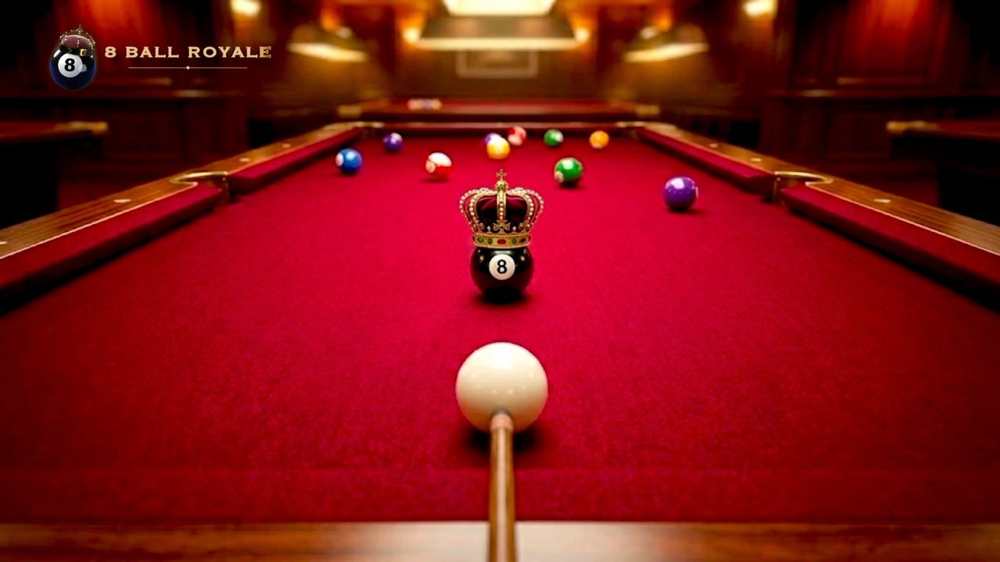
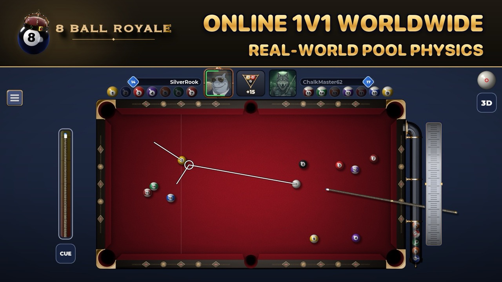
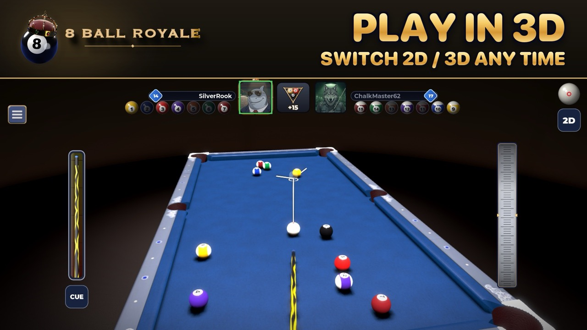
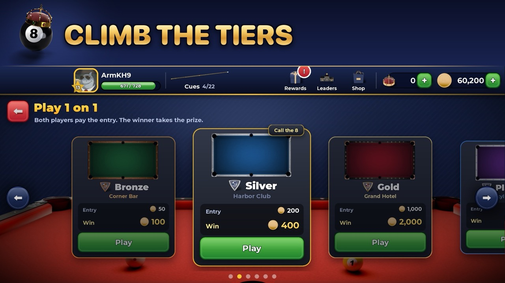

# 8 Ball Royal: Pool 1v1

A live 1v1 pool game on Roblox that I designed, built and run on my own.

**Play it:** https://www.roblox.com/games/113723817894570

## The game

- 8-ball and 9-ball, online 1v1 against real players across servers, plus practice bots
- Top-down 2D view and a 3D aim view, switchable at any moment
- Ranked tiers with coin stakes, a season pass, cues with stats, quick chat and mini games
- Works on phone, tablet and desktop (about 64% of players are on phones)

| Top view | 3D aim view |
|---|---|
|  |  |

## In numbers

- Launched on Oct 6, 2026
- About 500 players a day and growing every day, with no paid ads
- 1,200 commits and about 37,000 lines of Luau in the full project
- 37 automated test suites run in Lune, outside Roblox

## Architecture

- **Server-authoritative play.** The server simulates every shot and sends the result to both
  players, so the client can't fake a pot or move a ball.
- **Deterministic physics in pure Luau.** No Roblox services inside the simulation, so the same code
  runs on the server, in the aim guide and in the bots, and is tested from the command line.
- **Compact shot replays.** A shot is packed into a binary buffer (16-bit positions and spins, only the
  balls that changed each frame) before it goes over the network.
- **Cross-server matchmaking.** Players search a shared MemoryStore queue, get paired by level and
  teleport into one server, with a VS screen carried through the teleport.
- **Player data** in DataStores through ProfileStore, with session locking.
- **Every feature behind a config switch**, so anything can be turned off in a live game without a
  new release.
- **Tooling:** Rojo for syncing code into Studio, Lune for tests, Blender for 3D art and Python
  scripts for asset pipelines.

## Code in this repo

The full game is in a private repository. These are modules from it, unchanged apart from comments
and require paths:

| File | What it does |
|---|---|
| [src/PoolRules.luau](src/PoolRules.luau) | 8-ball rules: open table, groups, fouls, ball in hand, called pockets, the 8. |
| [src/PoolRules9.luau](src/PoolRules9.luau) | 9-ball rules on the same state, so callers don't need a second path. |
| [src/ShotCodec.luau](src/ShotCodec.luau) | Packs a simulated shot into a buffer for a RemoteEvent. |
| [src/Playback.luau](src/Playback.luau) | Monotone cubic interpolation between replay keyframes, so balls move smoothly and a stopping ball never overshoots. |

The physics engine and its fitted constants stay in the private repository. The constants were
fitted to frame-by-frame measurements of recorded shots (speed after the cue strike, spin, cushion
angles, breaks), and the tests check the simulation against those measurements.

These files depend on the rest of the project, so they are here to read, not to run.
